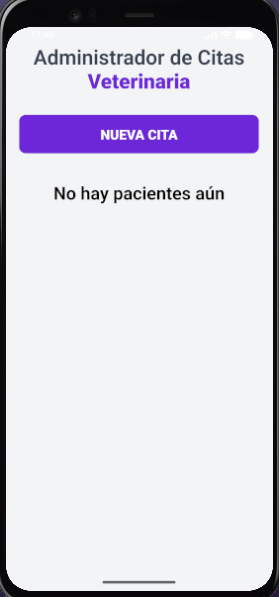
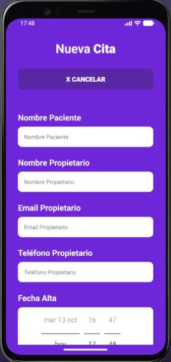
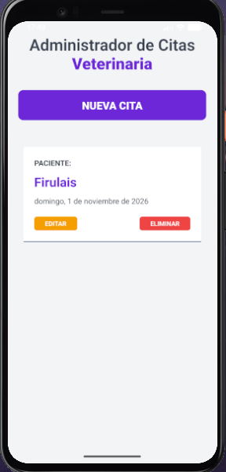
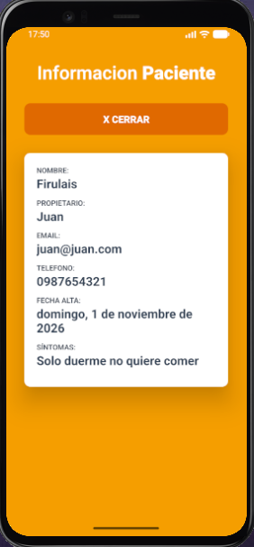
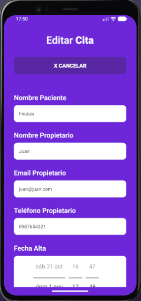
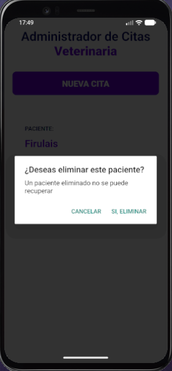

# 🐾 Citas Veterinaria — React Native

Aplicación móvil para administrar citas de una veterinaria. Desarrollada con **React Native 0.87** y la **New Architecture** (Bridgeless + Fabric).

Permite gestionar pacientes con operaciones CRUD completas: crear, listar, ver detalles, editar y eliminar citas veterinarias.

> ⚠️ **Persistencia:** por ahora los datos se guardan **en memoria**. Al cerrar la app, las citas se pierden. En futuras versiones se puede agregar persistencia local (AsyncStorage, SQLite, etc.).

> 📦 **APK de release:** en la raíz del proyecto se incluye `app-citas.apk`, una APK de release lista para instalar en Android sin depender de la PC. Para ver cómo se genera, consultá [`APK_BUILD.md`](APK_BUILD.md).

---

## 📸 Screenshots de la app

A continuación se muestran las principales pantallas de la aplicación:

### Pantalla de inicio


### Nueva cita


### Paciente creado


### Información del paciente


### Editar paciente


### Eliminar paciente


---

## 📋 Requisitos

- **Node.js** >= 22.11.0
- **Android SDK** (API 24+, compileSdk 37)
- **Android Emulator** o dispositivo físico conectado
- **Java JDK** 17+
- **Git Bash** o PowerShell (Windows)

> **Nota sobre iOS:** el proyecto incluye la carpeta `ios/` generada por React Native CLI, pero las instrucciones de este README están orientadas a Android. Para compilar en iOS se requiere macOS con Xcode. Si querés agregar soporte documentado para iOS, avisame.

---

## 🚀 Cómo levantar el proyecto

### Opción 1: Script automático (Recomendado)

Ejecutá el script que hace todo automáticamente:

```powershell
npm run android:full
```

Este script:
- Cierra Metro anterior si está corriendo en el puerto 8081
- Inicia el emulador si no está abierto
- Cierra y limpia la caché de la app anterior
- Inicia Metro bundler en una ventana separada
- Compila e instala la APK
- Reinicia la app para una conexión limpia

### Opción 2: Manual por pasos

**Paso 1 — Metro bundler:**

```bash
npx react-native start
```

**Paso 2 — Compilar e instalar:**

En otra terminal:

```bash
cd android
./gradlew clean
./gradlew :app:assembleDebug
cd ..
adb install -r android/app/build/outputs/apk/debug/app-debug.apk
adb shell am start -n com.citas/.MainActivity
```

---

## 🧪 Tests

El proyecto incluye Jest como runner de pruebas. Para ejecutarlos:

```bash
npm test
```

Por defecto se encuentra un test básico de renderizado de `App.tsx` en `__tests__/App.test.tsx`.

---

## 🪵 Cómo ver los logs (console.log / console.warn)

En React Native 0.87 con Hermes, los `console.log` a veces no aparecen en la terminal de Metro. Usá este comando para verlos en tiempo real:

```bash
adb logcat -s ReactNativeJS:D
```

**Filtrar solo tu app:**

```bash
adb logcat -s ReactNativeJS:D *:S
```

**Ver todo el log del sistema (útil para errores nativos):**

```bash
adb logcat
```

**Limpiar y empezar desde cero:**

```bash
adb logcat -c
adb logcat -s ReactNativeJS:D
```

---

## ⌨️ Comandos útiles de Metro

Una vez que Metro esté corriendo, presioná:

| Tecla | Acción |
|-------|--------|
| `r` | Recargar app(s) |
| `d` | Abrir Dev Menu |
| `j` | Abrir DevTools (React Native DevTools) |
| `Ctrl + C` | Cerrar Metro |

---

## 📁 Estructura del proyecto

```
react-native-citas/
├── android/              # Proyecto Android nativo
├── ios/                  # Proyecto iOS nativo (requiere macOS + Xcode)
├── screenshots/           # Capturas de pantalla para la documentación
├── src/
│   ├── components/
│   │   ├── Formulario.js          # Formulario crear/editar cita
│   │   ├── Paciente.js            # Tarjeta de paciente en lista
│   │   └── InformacionPaciente.js # Modal con detalles completos
│   └── helpers/
│       └── index.js               # Helpers reutilizables (formatearFecha)
├── App.tsx               # Punto de entrada principal
├── start.ps1             # Script automático de inicio
├── package.json
└── README.md
```

---

## ✨ Funcionalidades

- **Crear cita:** completá el formulario con nombre del paciente, propietario, email, teléfono, fecha de alta y síntomas.
- **Validación de fecha:** la fecha de alta debe ser obligatoriamente **posterior a hoy**; el picker nativo no permite seleccionar días anteriores.
- **Listar citas:** las citas guardadas se muestran en una lista desplazable.
- **Ver detalle:** mantené presionada una tarjeta para abrir el modal con información completa del paciente.
- **Editar cita:** presioná el botón *Editar* dentro de una tarjeta. Carga todos los datos del paciente.
- **Eliminar cita:** presioná el botón *Eliminar* dentro de una tarjeta. Aparece una alerta de confirmación.
- **Status bar visible:** los íconos del sistema (hora, batería) se muestran en oscuro sobre el fondo claro.
- **Teclado no tapa los inputs:** el formulario se ajusta para que el campo de síntomas sea visible mientras se escribe.

> Los botones *Editar*, *Eliminar* y *Cerrar* usan `onLongPress` para evitar acciones accidentales.

---

## 📦 Dependencias principales

| Paquete | Versión | Uso |
|---------|---------|-----|
| `react-native` | 0.87.1 | Framework principal |
| `react` | 19.2.3 | Librería React |
| `react-native-safe-area-context` | ^5.5.2 | SafeAreaView |
| `@react-native-community/datetimepicker` | ^9.2.1 | Selector nativo de fecha/hora |

> Nota: inicialmente se probó `react-native-date-picker`, pero se reemplazó por `@react-native-community/datetimepicker` para compatibilidad nativa en dispositivos Android 14.

---

## 📦 Build de release (APK firmada)

Para generar una APK de producción firmada:

### 1. Generar el keystore

```bash
cd android
keytool -genkeypair -v -keystore citas-release-key.keystore -alias citas -keyalg RSA -keysize 2048 -validity 10000
```

### 2. Configurar el keystore en `~/.gradle/gradle.properties`

```properties
CITAS_UPLOAD_STORE_FILE=citas-release-key.keystore
CITAS_UPLOAD_KEY_ALIAS=citas
CITAS_UPLOAD_STORE_PASSWORD=tu_clave
CITAS_UPLOAD_KEY_PASSWORD=tu_clave
```

### 3. Actualizar `android/app/build.gradle`

Agregar dentro del bloque `android { ... }`:

```gradle
signingConfigs {
    release {
        if (project.hasProperty('CITAS_UPLOAD_STORE_FILE')) {
            storeFile file(CITAS_UPLOAD_STORE_FILE)
            storePassword CITAS_UPLOAD_STORE_PASSWORD
            keyAlias CITAS_UPLOAD_KEY_ALIAS
            keyPassword CITAS_UPLOAD_KEY_PASSWORD
        }
    }
}

buildTypes {
    release {
        signingConfig signingConfigs.release
        minifyEnabled enableProguardInReleaseBuilds
        proguardFiles getDefaultProguardFile("proguard-android-optimize.txt"), "proguard-rules.pro"
    }
}
```

### 4. Generar la APK

```bash
cd android
./gradlew assembleRelease
```

La APK resultante quedará en:

```
android/app/build/outputs/apk/release/app-release.apk
```

### Atajo con npm

También podés usar el script ya configurado en `package.json` para compilar la APK de release y copiarla directamente a la raíz del proyecto como `app-citas.apk`:

```bash
npm run build:apk
```

---

## 🛠️ Solución de problemas

### Pantalla en negro / App no carga

```bash
adb shell am force-stop com.citas
adb shell pm clear com.citas
adb install -r android/app/build/outputs/apk/debug/app-debug.apk
adb shell am start -n com.citas/.MainActivity
```

### Emulador no se detecta

```bash
adb devices
```

Si no aparece, iniciá el emulador manualmente:

```bash
emulator -avd Pixel_4
```

### Error "Metro ya está corriendo"

Matá el proceso anterior:

```bash
netstat -ano | findstr 8081
taskkill /F /PID <PID>
```

### Selector de fecha no se muestra en Android 14

El proyecto usa `@react-native-community/datetimepicker`, que abre el diálogo nativo de fecha de Android. Si experimentás problemas, verificá que la dependencia esté correctamente instalada:

```bash
npm install @react-native-community/datetimepicker
```

### Status bar no se ve sobre fondo claro

La app configura `StatusBar` con `barStyle='dark-content'` y fondo `#f3f4f6` para que hora, batería e íconos del sistema sean visibles.

---

## 🧹 Limpieza de archivos generados

Si el proyecto ocupa varios GB, es por archivos generados durante la compilación. El `.gitignore` ya evita que entren en git, pero los archivos siguen ocupando espacio en disco de forma local.

Estas carpetas se pueden borrar de forma segura:

```bash
cd /c/laragon/www/react-native-citas

rm -rf android/app/build
rm -rf android/app/.cxx
rm -rf android/.gradle
rm -rf android/build
rm -rf node_modules
```

O podés usar el script ya configurado en `package.json`:

```bash
npm run clean:deps
```

Esto libera aproximadamente **3.9 GB**. El código fuente, los tests y las capturas de pantalla quedan intactos.

### Regenerar el proyecto después de limpiar

```bash
npm install
npm run build:apk
```

Este comando compila la APK de release y la copia directamente a la raíz como `app-citas.apk`.

Si preferís hacerlo paso a paso manual:

```bash
npm install
cd android && ./gradlew assembleRelease
```

La APK de release se generará nuevamente en:

```
android/app/build/outputs/apk/release/app-release.apk
```

---

## 👨‍💻 Autor

- **Yamil Zaracho**
